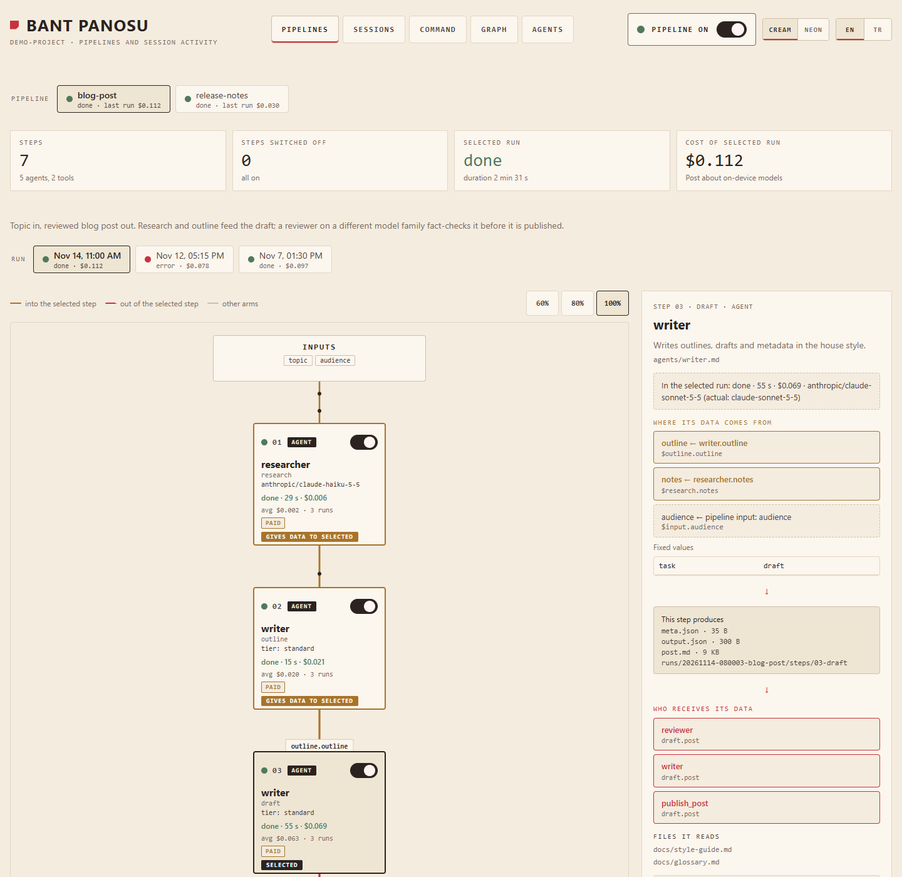
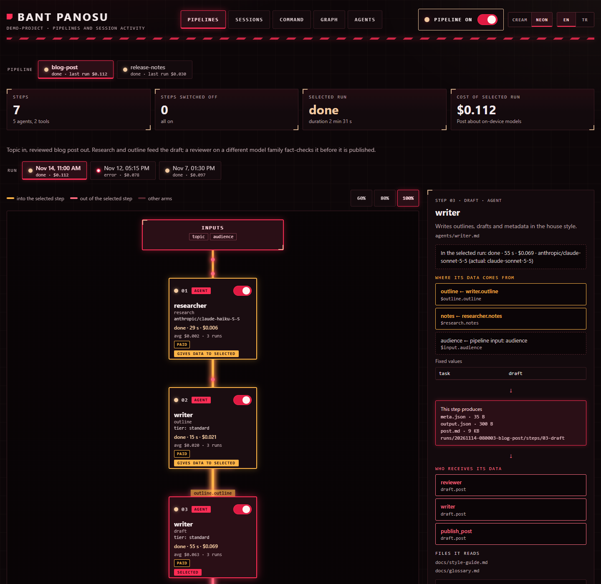
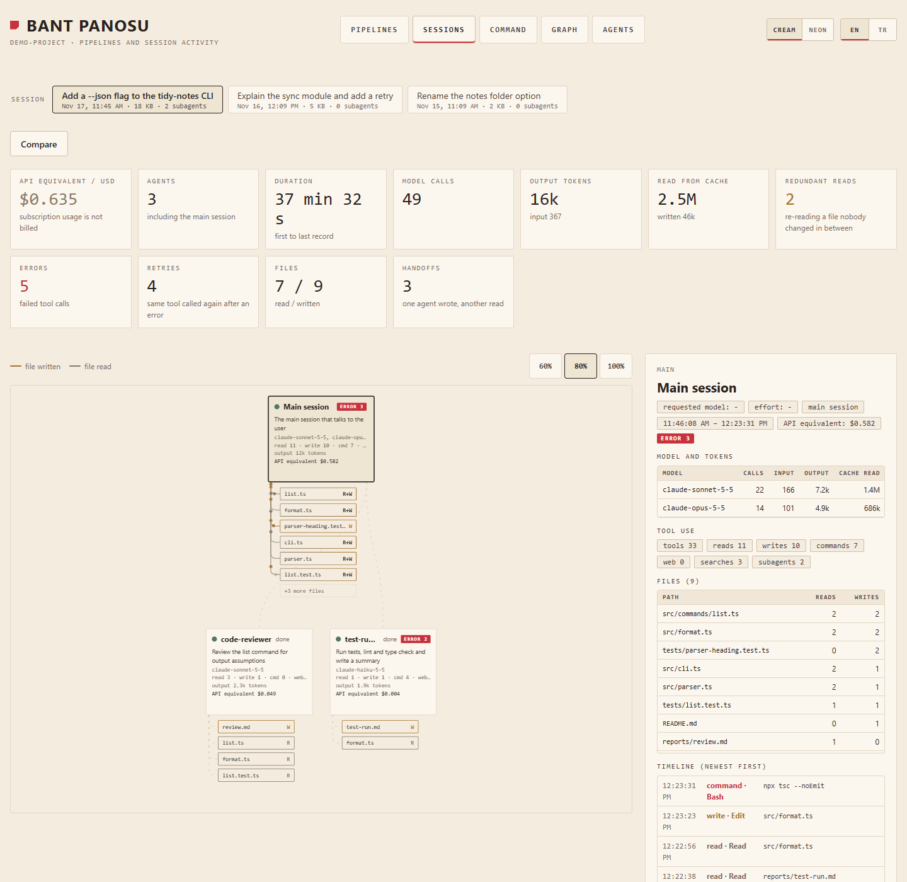
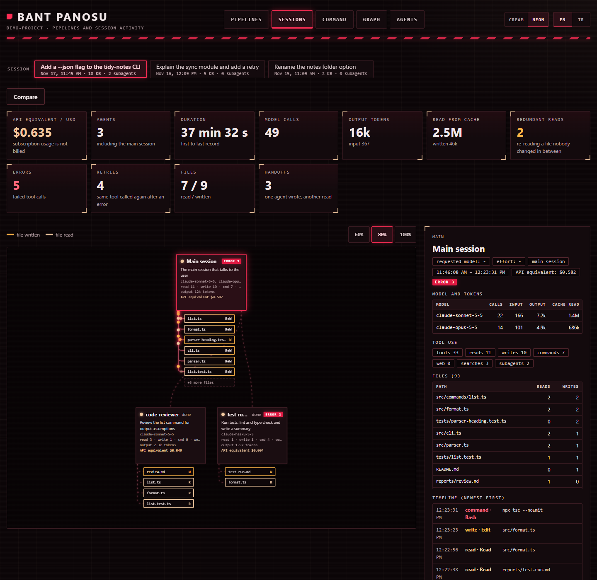
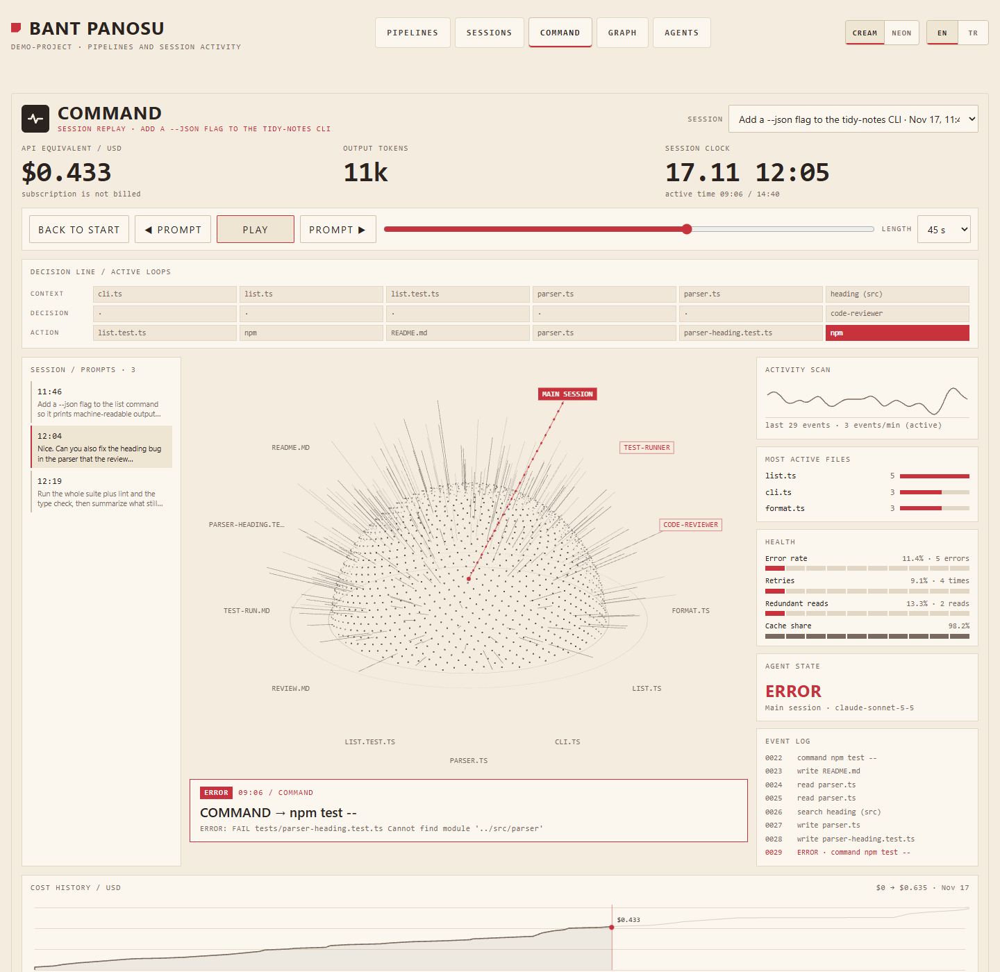
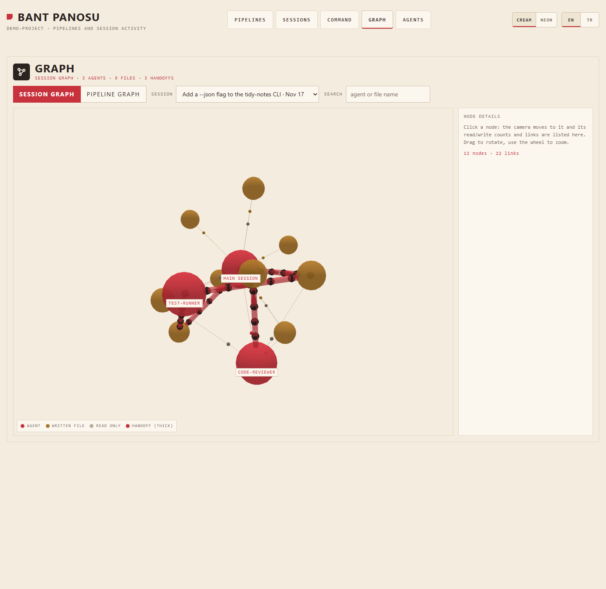

# Bant Panosu

A local dashboard that shows what your Claude Code sessions and YAML agent pipelines are doing: who read which file, which subagent ran on which model, what it cost, and where things went wrong.

<p>
  
  
</p>

*"Bant" is Turkish for "belt" or "pipeline"; "pano" is a board. Everything runs on your machine, reads files that are already there, and sends nothing anywhere.*

## What it shows

- **Live session.** Files read and written, commands run, searches, web fetches, per agent. A running session refreshes every 3 seconds.
- **Subagents.** Every subagent with its requested and actual model, effort, token counts, cost and what it handed to whom.
- **Cost by model.** Output, input and cache tokens turned into an *API list-price equivalent* (a subscription is not billed per token; this is what the same usage would cost on the API), split by agent and by model.
- **File heat map and redundant reads.** Which files are touched most, and how often an agent re-reads a file nobody changed in between.
- **Errors and retries.** Failed tool calls, and the same call tried again after an error with its outcome.
- **Session replay (Command tab).** Play a whole session back as a HUD: a particle sphere with the current target, the decision line, cumulative cost, event density, prompts you can jump between.
- **Compare.** Two sessions side by side: time, calls, tokens, cost, errors, redundant reads, model split, file overlap.
- **3D graph.** Agents and files (or pipeline steps) as a force-directed 3D network; handoffs are the thick links.
- **Pipelines as an octopus diagram.** Steps are cards, data flows along the arms. Each step has an on/off switch, and you can change the model of an agent with a preview of what the change will affect. Optional, see below.
- **Phone view.** `--phone` serves a read-only view to your phone on the same network.

<p>
  
  
</p>
<p>
  
  
</p>

All screenshots use made-up demo data (see `npm run demo`).

## Try it in 30 seconds

```bash
git clone <this repository> bant-panosu
cd bant-panosu
npm install
npm run demo
```

Open http://127.0.0.1:4517. `npm run demo` writes three invented Claude Code sessions (a tiny "tidy-notes" CLI, two subagents, a few errors) into `examples/demo-claude-home/` and starts the board on `examples/demo-project/`. It reads and writes nothing outside this folder.

## Use it on your own project

Requires Node 22.6 or newer (Node 24 runs the TypeScript directly; on 22.6+ the start script passes `--experimental-strip-types`).

```bash
npm install
npm start -- --project /path/to/your/project
```

The sessions come from `~/.claude/projects/<encoded project path>/`, where Claude Code keeps its transcripts. Nothing to install in Claude Code, no hooks.

| Flag | Default | Meaning |
|---|---|---|
| `--project <path>` | current directory | Project whose sessions and pipelines are shown |
| `--port <n>` | `4517` | Port |
| `--claude-home <path>` | `$CLAUDE_CONFIG_DIR` or `~/.claude` | Where Claude Code stores `projects/` |
| `--pipelines <path>` | `<project>/pipelines` | Pipeline YAML files |
| `--agents <path>` | `<project>/agents` | Agent `.md` files of the pipelines |
| `--runs <path>` | `<project>/runs` | Run records |
| `--models <path>` | `<project>/config/models.yaml` | Optional tiers and provider info |
| `--state <path>` | `<project>/.bant-panosu` | Where `switches.json` and `changes.jsonl` are written |
| `--tasks-folder <name>` | off | Windows only: show a Task Scheduler folder, for example `"\MyTasks\"` |
| `--phone` | off | Read-only access from your phone (see Security) |

In the browser: `?theme=cream` or `?theme=neon` (the default is cream; the buttons in the header remember your choice), `?lang=tr` for Turkish (EN is the default), `?tab=sessions` to open a tab directly.

## Pipelines (optional)

The Pipelines tab appears only when the pipelines folder contains at least one `*.yaml` file. Without it, the board shows the session views and says so. A small example lives in `examples/demo-project/`.

**Pipeline file** (`pipelines/blog-post.yaml`):

```yaml
name: blog-post
description: Topic in, reviewed post out.
inputs:
  topic: { description: What the post is about }
steps:
  - id: research            # unique within the pipeline
    agent: researcher       # an agent file: agents/researcher.md
    inputs:
      topic: $input.topic   # $input.<name> reads a pipeline input
  - id: draft
    agent: writer
    inputs:
      notes: $research.notes   # $<step>.<field> reads an earlier step; this draws an arm
  - id: fact_check
    agent: reviewer
    review: true            # marks a review step (badge, and a family-independence warning)
  - id: seo_pass
    agent: writer
    optional: true          # can be switched off without stopping the pipeline
  - id: publish
    tool: publish_post      # a tool step: plain code, no model
    description: Pushes the draft to the CMS
    inputs:
      all: $previous_steps  # $previous_steps = depends on every earlier step
```

**Agent file** (`agents/researcher.md`), YAML front matter, the body is the prompt and is ignored by the board:

```yaml
---
name: researcher
role: Gathers facts and sources.      # shown under the step name
model:
  primary: google/gemini-3-flash      # or `tier: standard` (see models.yaml)
  fallbacks:
    - anthropic/claude-haiku-5-5
reads: [docs/style-guide.md]          # files the agent is told to read
output:
  files:
    - { name: notes.md }
---
```

**Models config** (`config/models.yaml`, optional): `tiers:` maps a tier name to a list of models (first is primary, rest are fallbacks), `providers:` marks providers with `paid: true` so the board can show a "paid" badge.

**Run records** (`runs/<YYYYMMDD>-<HHMMSS>-<pipeline>/run.json`) are written by your orchestrator; the board only reads them:

```json
{
  "id": "20261114-080003-blog-post", "pipeline": "blog-post", "status": "done",
  "createdAt": "2026-11-14T08:00:03Z", "updatedAt": "2026-11-14T08:02:34Z", "totalUsd": 0.112, "note": "optional label",
  "steps": { "research": { "order": 0, "status": "done", "model": "anthropic/claude-haiku-5-5", "durationMs": 29000, "usd": 0.006 } }
}
```

Statuses: `done`, `running`, `error`, `skipped`, `waiting`, `awaiting-approval`. Tool steps use `"model": "tool/<name>"`. Files in `runs/<id>/steps/<NN>-<step>/` (NN = `order` + 1) are listed in the step panel; an optional `meta.json` there with `{ "actualModel": "..." }` shows the real model next to the requested one.

### Connecting the switches to your orchestrator

The board never starts or stops anything. When you flip a switch it writes `<state>/switches.json` (only things that are OFF are stored):

```json
{ "pipelines": { "blog-post": false }, "steps": { "blog-post": { "seo_pass": false } } }
```

Your orchestrator reads that file before each step. `examples/switch-reader.ts` is a ready-made reader you can copy; it fails open (a missing or broken file means everything is on, so the board cannot lock your pipelines). The behavior the board's "What happens if you turn it off" text assumes:

| Switched off | Orchestrator should |
|---|---|
| an `optional` step | skip it (`skipped`) and continue |
| a step that is not optional | stop the run there (`awaiting-approval`); later steps do not run; resume once it is back on |
| the whole pipeline | run nothing; the run waits (`awaiting-approval`) |

Changing a model rewrites only the `primary:` (or `tier:`) line of the agent file, keeps comments and every other line, re-parses the file and restores it if the result is not what was asked. If the new model was a fallback, it swaps places with the old primary. Every change is appended to `<state>/changes.jsonl`.

### Task Scheduler strip (Windows, optional)

`--tasks-folder "\MyTasks\"` adds a read-only Tasks tab for one Task Scheduler folder: state, last and next run, last result, and the pipeline a task runs (found by looking for a pipeline name in the task's command or the `.cmd`/`.bat` it starts). It never creates, changes or runs tasks. It is off by default and does nothing on other systems.

## Security and privacy

- **Local only.** The server binds to `127.0.0.1`. Requests whose `Host` header is not `127.0.0.1`/`localhost` are refused (DNS rebinding).
- **No data leaves your machine.** The board makes no outbound requests, loads no `.env`, and the page loads no CDN script or font.
- **Writes need a token.** The three write endpoints (switch, pipeline model, subagent model) require a random per-start token that is embedded in the page, so another website cannot make your browser write through the server.
- **`--phone` mode.** Binds to the network, but accepts only private addresses (10/8, 172.16/12, 192.168/16), needs the access key printed at start (`http://<ip>:4517/?key=...`; stored in an HttpOnly cookie for a day), and is strictly read-only: every write is refused for non-local clients. The key changes on each start.
- **Secret masking.** In commands, URLs and error text shown by the board, `NAME=value` pairs with key/token/secret/password-like names, bearer tokens, `sk-`, GitHub, AWS and Slack token shapes, private key blocks and URL credentials are masked, and text is shortened (commands to 160 characters, prompts to 90). Masking is a safety net, not a guarantee: the transcripts on your disk still contain whatever they contain, and the board shows file paths and the first words of your prompts. Do not put screenshots of a real session in public places.
- Only plain files directly inside `web/` are served; the API never returns absolute paths of your project.

## Prices

Costs are computed from `prices.json` (USD per 1M tokens: input, output, cache read; cache writes are 1.25x input). **The table is updated by hand.** Check it against the official pricing page and edit it when prices or models change. A model that is not in the table is left out of the totals and the board shows a warning with its name.

## Limits

- Only Claude Code transcripts are read. **Codex sessions are not supported yet.**
- **Files written through Bash/PowerShell do not show up as files**; only the command is visible.
- The cost is an API-equivalent estimate, not a bill.
- Sessions are read from disk as Claude Code writes them; the transcript format is not a public contract and can change.
- Error messages from the server are in English in both languages.
- The 3D graph needs WebGL.

## Development

```bash
npm test                          # API, security, parsing, write endpoints (on a temporary copy of the demo)
node scripts/extract-keys.mjs --check   # every UI text has a Turkish translation
```

The code is plain TypeScript run by Node (no build step) on the server and plain JS in the browser. The only dependency is [`yaml`](https://github.com/eemeli/yaml). The 3D view uses the bundled `web/3d-force-graph.min.js` (MIT, see `THIRD_PARTY.md`). UI texts are English keys; Turkish is in `web/translations-tr.js`.

## License

MIT, Copyright (c) 2026 Sayıyla. See `LICENSE` and `THIRD_PARTY.md`.

## About

Bant Panosu is built and used by [Sayıyla](https://sayiyla.com/?utm_source=github&utm_medium=readme&utm_campaign=bant-panosu), a Turkish publication that tests AI tools with real numbers. We run our own content pipelines with Claude Code and built this board to see what they do.

Related reading on sayiyla.com (Turkish):

- [Claude Code setup on Windows, Mac and VS Code](https://sayiyla.com/yazilar/claude-code-kurulumu-windows-mac-vscode-rehberi/?utm_source=github&utm_medium=readme&utm_campaign=bant-panosu)
- [Blocking commands with Claude Code hooks](https://sayiyla.com/yazilar/claude-code-hooks-komut-engelleme/?utm_source=github&utm_medium=readme&utm_campaign=bant-panosu)
- [10 AI coding agents compared](https://sayiyla.com/yazilar/ai-kodlama-ajanlari-10-arac-karsilastirmasi/?utm_source=github&utm_medium=readme&utm_campaign=bant-panosu)
- [Claude Max 5x / 20x: prices and limits](https://sayiyla.com/yazilar/claude-max-5x-20x-nedir-fiyatlari-ve-limitleri/?utm_source=github&utm_medium=readme&utm_campaign=bant-panosu)
- [AI API prices, side by side](https://sayiyla.com/api-fiyatlari/?utm_source=github&utm_medium=readme&utm_campaign=bant-panosu)
- [Open-source AI repos we track](https://sayiyla.com/repolar/?utm_source=github&utm_medium=readme&utm_campaign=bant-panosu)

Project page: [sayiyla.github.io/bant-panosu](https://sayiyla.github.io/bant-panosu/)
